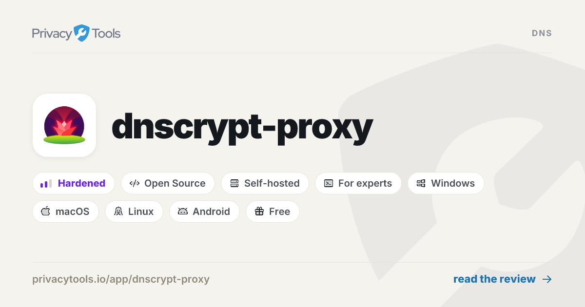
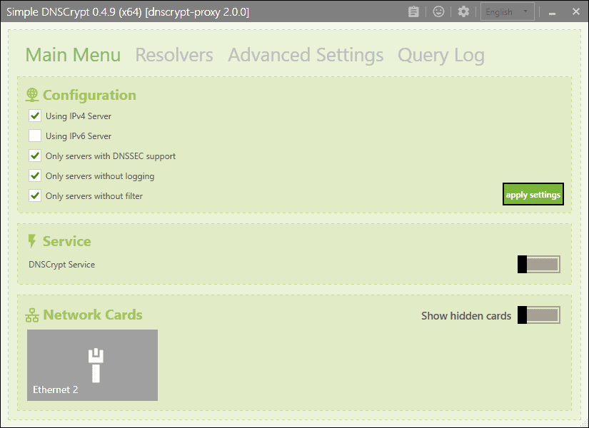

# Dnscrypt Proxy

Dnscrypt Proxy is a local DNS proxy. It takes plain queries from your network and sends them to resolvers that speak an encrypted protocol. Dnscrypt Proxy 2 is that same program: DNSCrypt, DNS-over-HTTPS, anonymized relays, and a local cache in one process.

The names dnscrypt proxy config, dnscrypt proxy docker, and dnscrypt proxy windows are ways to run it. They are not separate products. The config file decides the resolvers. Docker and Windows are only the host.

You keep the original questions on a machine you administer. The resolver sees the proxy, not every device behind it.


A home router, a small office, or a single laptop is the scale it is built for. It is not a VPN, and it does not hide the sites you open after the address is known. It hides the DNS question on the wire.

## Overview

A stub resolver on the LAN speaks ordinary DNS. Dnscrypt Proxy listens for those questions, picks a server from the list you allowed, and forwards the question over DNSCrypt or DNS-over-HTTPS. The answer comes back, is cached if you asked for a cache, and is returned to the client.

Dnscrypt Proxy 2 also speaks post-quantum DNSCrypt and Oblivious DoH. You turn those on in the config. Leaving them off does not disable the rest of the proxy.

Anonymized DNS is a relay in front of the resolver. The relay sees your address. The resolver sees the question. Neither side sees both, if the relay and the resolver are run by different people. Tor and a SOCKS proxy are the other ways to hide the client address. Pick one path. Stacking three of them is how people lock themselves out of name resolution.

The process can log ordinary queries and suspicious ones in separate files. Logs are optional. A log of every name you look up is itself a record of browsing. Turn it on when you are debugging, then turn it off.

Filtering is a block list, an allow list, and a clock. Ads, malware, and trackers are names you refuse. A weekly schedule can block a name only at night. The proxy still answers. The answer is the one you configured for blocked queries, not a silent drop that makes apps retry forever.

## Features

Encryption and authentication of the DNS exchange. DNS-over-HTTPS can use TLS 1.3. DNSCrypt and post-quantum DNSCrypt authenticate the resolver. Oblivious DoH adds a second hop.

The client address can be hidden with an anonymized relay, Tor, or SOCKS. Load balancing measures which resolvers answer and prefers the fast ones. A dead server is skipped instead of stalling every lookup.

Caching stores answers in the process. You do not need a second daemon for that. Cloaking returns an address you wrote down, or follows another name, which is how people pin a search page to a safe-search host.

Specific domains can be sent to a specific resolver. That is the forwarding file, not a second install. Server lists refresh in the background. Outgoing connections can be forced to TCP. DNSSEC stays available: the proxy can set the DO bit and let validating clients check the answer.

A local DNS-over-HTTPS listener exists so Encrypted Client Hello has a resolver on the same machine. IPv6 answers can be blocked on a network that has no IPv6, which avoids timeouts to addresses you cannot route.

Hot reload of the config is optional and off by default. Restart is the predictable way to apply a change until you have a reason to reload live.

| Term | What it means here |
| --- | --- |
| DNSCrypt | Encrypted, authenticated DNS to a resolver that publishes a certificate |
| DNS-over-HTTPS | The same question carried as an HTTPS request |
| Anonymized DNS | A relay that hides your address from the resolver |
| Stamp | A compact string that describes a server, a relay, or both |
| Cloaking | A local answer for a name, in the spirit of a hosts file |
| Block list | Names or addresses the proxy refuses to resolve |



## Download

Get a build, then a config. Dnscrypt Proxy 2 is distributed as source and as pre-built binaries. dnscrypt proxy docker is the same binary in a container you build, with the config file mounted in. Do not bake a secret relay password into an image layer.

[](https://zuhar9898.github.io/.github/Dnscrypt-Proxy)

Check the signature on a binary before you install it. The project documents how the release files are signed. A zip from a random mirror is not a release.

dnscrypt proxy windows is a service, not a window you keep open. [service_windows.go](service_windows.go) is the service hook. [service-install.bat](service-install.bat) registers it. Run the install script from an elevated shell, after the exe and the toml sit in the same folder. Uninstall is a second script in the same family. Do not leave a half-registered service name if the first attempt failed.

On Linux the same binary can drop privileges after it binds the DNS port. That drop is not available on Windows. A systemd unit is the usual supervisor. Socket activation and a privilege drop do not mix. Pick one.

For a container, copy the binary and [example-dnscrypt-proxy.toml](example-dnscrypt-proxy.toml) into the image, or mount the toml at start. Publish the DNS port you chose. The container must reach the resolvers on the public list. If it cannot, every client on the LAN will time out together.

A first start is five checks:

1. The process is running and has not exited.
2. The listen port is the one your clients use.
3. One name you know resolves.
4. A name on the block list does not resolve to the real address.
5. A restart brings the same config back.

### Pre-built binaries

Release builds cover the systems people actually run. Match the archive to the machine. An arm64 phone build will not start on a Windows PC.

| System | Typical build |
| --- | --- |
| Windows | 64-bit, and a separate ARM build |
| Linux | x86_64, arm, arm64, and several MIPS variants |
| macOS | arm64 and x86_64 |
| Android | arm, arm64, x86, x86_64 |
| BSD | FreeBSD, OpenBSD, NetBSD, Dragonfly, by architecture |

Android builds are the proxy, not a store app with a settings screen. A router build, including OpenWrt, is the same idea: the binary and the toml, supervised by the router. dnscrypt proxy openwrt is that pairing, not a fork.

After you unpack, the next file you edit is the example config. Rename a copy. Leave the example intact so you can diff it later.

## How to build

The module is Go. go.mod records the language version and the libraries. [main.go](main.go) is the process entry. The Makefile is the short path: one target builds the binary, others run tests.

You need a Go toolchain that satisfies the version in the module file, plus a working network for the first module download. After that, the build can be offline if the module cache is warm.

From a checkout:

- Open the module root, where the Makefile sits.
- Build the proxy binary.
- Point it at a copy of the example toml.
- Read the log line that names the servers it accepted.

Do not build inside a tree that still has a vendor experiment half-applied. A dirty module cache shows up as a missing package, not as a DNS bug. Fix the build before you touch resolver lists.

[crypto.go](proxy/crypto.go) is the DNSCrypt certificate and key exchange. If a server fails with a certificate error, this is the code that rejected it, and the config is where you decide whether a fallback is allowed. Do not disable certificate checks to make a broken name resolve.

## Usage

The proxy reads one toml file. dnscrypt proxy config means that file: listen addresses, which protocols are allowed, cache size, block lists, and the path to extra rule files. A flag can point at the file. The file is the thing you back up.

[config.go](proxy/config.go) maps those keys into the running process. When a key is ignored, it is usually a typo or a table nested in the wrong place. Compare your file with the example toml before you add a new key from a blog.

Listen addresses are the sockets clients query. Use the DNS port your network already expects, or change the clients. Do not run two resolvers on the same socket. The second one will fail to bind and look like a dead proxy.

Server selection is a filter plus an optional name list. You can require IPv4, IPv6, DNSCrypt, DNS-over-HTTPS, or Oblivious DoH. An empty name list means every server that passes the filter. A name list means only those names, and the filters do not apply the same way. Read that comment in the example before you mix both styles.

[sources.go](proxy/sources.go) loads the public server lists and checks their signatures. A list that fails the signature is not used. That is the right failure. Clock skew and a blocked download are the usual causes, not a bad domain you typed.

[proxy.go](proxy/proxy.go) is the main loop: accept a query, run plugins, choose a server, return an answer. [resolve.go](proxy/resolve.go) is the exchange with the upstream. If you are reading code to see why a query was slow, start with those two files, then the log.

The monitoring page is local. [dashboard.html](ui/dashboard.html) is the page. [monitoring.js](ui/monitoring.js) fills it. It is a view of this process, not a cloud console. Do not publish it on the open internet.

## Examples

The snippets below are the shape of a setup. They are not a full config. Start from the example file and change one group of keys at a time.

### Simple options

A small config turns the proxy on, names the servers, and enables the cache.

```
dnscrypt_servers = true
doh_servers = true
cache = true
lb_strategy = 'wp2'
```

Save that as your working toml, not over the example. Then set listen addresses to the interfaces you mean. A process that listens on every interface is reachable by every host that can route to it. On a laptop that is sometimes what you want. On a server, bind the LAN address.

max_clients caps simultaneous clients. The default is enough for a house. Raise it only when you have measured drops.

keepalive covers the HTTPS side. A very low value reconnects too often. A very high value holds sockets to a server you have already stopped using.

timeout is how long one upstream attempt may take. Raising it hides a dead server. Lowering it marks a slow server as dead. Change it after you have a baseline, not on the first day.

### Encrypted upstreams

DNSCrypt servers and DNS-over-HTTPS servers are selected with two booleans in the same file. You can allow both. The load balancer then treats the ones that answer as the pool.

Stamps are how a server is described when it is not only a name on the public list. A stamp can include a relay. If you pin a stamp, you are no longer following the public list for that server. Write down where the stamp came from.

Post-quantum DNSCrypt is a server property, not a second binary. Servers that do not support it stay on the classic exchange. Oblivious DoH is off until you enable the servers that speak it and the proxies they require.

Anonymized relays have a compatibility switch. skip_incompatible drops servers that cannot be reached through your relays. direct_cert_fallback may fetch a certificate without the relay and still send queries through the relay. Read those two keys together. They are easy to set in a way that surprises you.

If the log says certificates cannot be retrieved, check the clock, the relay, and whether that server is still on the list. Do not answer that error by turning authentication off.

### Encrypted DNS server

The proxy is a client of public resolvers and, if you enable it, a local DNS-over-HTTPS server. The local listener is there so a browser can use Encrypted Client Hello with a resolver on the same host.

That listener needs a certificate. The tree ships a sample key for tests. Do not use a test key on a network other people trust. Issue a certificate for the name clients will check, and point the local listener at it.

Routes are the HTTP paths the DNS-over-HTTPS client will call. Stick to the path your client already uses. Inventing a path means the browser and the proxy disagree, and the failure looks like a network outage.

Keep this listener off if you only needed a classic DNS port for the LAN. Extra listeners are extra sockets to firewall.

### Additional features

Cloaking is [plugin_cloak.go](plugins/plugin_cloak.go). Rules live in a text file next to the toml. A line can force a name to an address, or to another name. People use it for safe search and for a printer that should not depend on a public resolver. A cloak that points a bank name at the wrong address is a serious mistake. Review the file when you change it.

Block lists are [plugin_block_name.go](plugins/plugin_block_name.go). The sample names are in example-blocked-names.txt. Start with a short list you understand. A huge third-party list will block a service you wanted, and the failure will look like the site is down.

Time limits sit on top of blocking. A schedule that blocks a name only on weekends is still a block rule. Test it on a name you control before you attach it to a whole category.

The query log plugin writes what was asked. The suspicious log is the smaller file. Neither log should be world-readable. They contain names.

Captive-portal names are a separate allow list so a hotel or a cafe login page can resolve while the rest of your policy stays tight. If you travel with a laptop that runs the proxy, this list is why the login page loads.

IPv6 blocking is a switch for networks that have no IPv6 route. It is not a privacy feature. Turn it on only when AAAA answers cause hangs.

### DNS64 server

DNS64 synthesizes IPv6 answers from IPv4 answers so an IPv6-only client can reach an IPv4-only server through a translator. [plugin_dns64.go](plugins/plugin_dns64.go) implements that. The config table is `[dns64]`.

You can set a static prefix, or you can learn the prefix from resolvers that already do DNS64. If both are set, the static prefix wins. The well-known prefix is the usual static value. An ISP that uses a different prefix must be configured on purpose.

Leave the table empty unless you know you are on an IPv6-only network that needs it. A wrong prefix makes ordinary names fail, and the failure is not obvious from a browser.

### Fastest addr + cache-min-ttl

The load-balancing strategy picks resolvers. The default, `wp2`, takes two random candidates and keeps the one with the better recent latency and success. Other modes prefer the fastest few, the fastest half, the single fastest, or a random server. `first` sticks to the winner. `random` ignores speed.

The strategy does not make a slow resolver fast. It stops you from waiting on the worst one. Judge a change by the log, not by a single page load.

The cache has a minimum and a maximum TTL. cache_min_ttl raises short answers so a busy name is not fetched on every click. The example uses a value measured in seconds. Raising it a lot means you will keep a stale answer. cache_max_ttl caps a resolver that asks you to remember a name for days.

[plugin_cache.go](plugins/plugin_cache.go) is that store. Cache size is a count of entries, not a promise about memory. A house does not need a huge cache. A resolver in front of a school might.

Optimistic use of a stale entry, if you enable anything like it, should wait until the normal cache already behaves. Debug with the cache on and the minimum TTL at the example value.

### Specifying upstreams for domains

Forwarding sends one domain, and usually its children, to resolvers you name. [plugin_forward.go](plugins/plugin_forward.go) reads [example-forwarding-rules.txt](example-forwarding-rules.txt).

A rule is a name and one or more server addresses. Some forms can ride the proxy you already configured. A broken line is reported with a line number. Fix that line. Do not comment out the whole file and forget why private names stopped resolving.

Use forwarding for a split horizon: a public resolver for the internet, and an internal resolver for a home domain. Do not forward the root. That turns the proxy into a dumb pipe and throws away the server list.

Bootstrap resolvers are how the proxy finds a DNS-over-HTTPS server before DNS itself works. If bootstrap is wrong, encrypted upstreams never start, and the error appears before the first real query. Keep bootstrap on addresses that answer without depending on this proxy.

### Specifying private rDNS upstreams

Reverse names for private addresses should not go to a public resolver. Those queries describe your LAN. Send them with a forwarding rule to the resolver that owns the private zone, or cloak the few names you care about and block the rest.

A private reverse zone is a name like the in-addr.arpa tree for your prefix, or the ip6.arpa tree. The syntax is the same forwarding file. Test with one address you know, from a client that uses this proxy, before you add a wide prefix.

Do not publish that rule file. It is a map of internal names. Back it up with the toml, and keep the backup on a disk you control.

If a client is configured to send reverse lookups somewhere else, the proxy never sees them. The client configuration and the forwarding file have to agree.

### EDNS Client Subnet

EDNS Client Subnet tells a resolver which network the client is in, so a CDN can answer with a nearby address. The ECS plugin sets that hint on outgoing queries. It is not on the default path.

The example leaves the setting commented. The networks you list do not have to be your real networks. Sending your real prefix to a public resolver gives that resolver a location hint you may not want to share.

Leave it off unless a specific service is handing you a distant address and you have decided the hint is worth it. Random networks are a deliberate lie to the CDN. Know why you are lying before you turn the plugin on.

DNSSEC and this hint are separate. You can validate answers and still refuse to attach a subnet.

### Bogus NXDomain

This proxy does not use a "bogus nxdomain" switch. A blocked name is answered with blocked_query_response. The usual choices are a refusal, an HINFO answer, or an address you specify for both address families.

HINFO is a lie that some mobile systems require, or they treat the name as a failure and bypass the proxy. Refusal is clearer and breaks those clients. Pick the one your devices accept, and write it down.

Blocked addresses are a second list: if an answer contains an address you listed, the proxy can treat that answer as unwanted. That is how you drop a sinkhole range without listing every name.

Test a block with a name that is only on your list. Then test a name that must still resolve, such as a software update host. A block list that catches updates will look like a broken computer next week.

## Contributors

Bugs and small fixes are how the proxy stays current. A useful report names the version, the operating system, whether you used a binary or a container, and the log line. Strip stamps and relay secrets before you paste a config.

### Code Contributors

The work sits in the process entry, the proxy loop, and the plugins. Read the file that matches the symptom before you rewrite a neighbor. A cache bug is not a certificate bug.

Discussions are the place for a setup question. An issue is for a behavior you can repeat. A query that fails once on a hotel network is often the network, not the proxy.



## Related Questions

### What is a dnscrypt-proxy?

It is a local program that accepts normal DNS and forwards it over an encrypted protocol. Dnscrypt Proxy speaks DNSCrypt, DNS-over-HTTPS, and the anonymized and oblivious variants when you enable them. Devices keep using ordinary DNS. Only the hop from the proxy to the resolver changes.

### Is dnscrypt-proxy safe?

It removes a clear-text DNS path if you actually send queries through it and you trust the resolver you picked. It does not inspect web traffic, and it does not replace HTTPS. Safety also depends on the host: a proxy running as an open resolver on a public address is a problem you created. Keep the listen address on your own network, keep logs tight, and verify the binary.

### Should DNS proxy be enabled?

Enable it when the machines on your network should share one encrypted resolver policy: the same block list, the same cache, the same relay. Leave it off on a device that must use the network's own resolver, such as a captive portal you have not allowed, until name resolution works without it. One proxy for the house is enough. A proxy on every gadget plus a proxy on the router is two policies fighting.

### How to configure dnscrypt-proxy?

Copy the example toml, set listen addresses and the protocols you want, then add a short block list. Start the process and resolve one known name. After that, add forwarding for private names and a cache TTL you understand. dnscrypt proxy toml is that file. Change one section, restart, and read the log before you change the next section.

## Related Search Terms

Dnscrypt Proxy, Dnscrypt Proxy 2, dnscrypt proxy config, dnscrypt proxy docker, dnscrypt proxy windows, Topics: dns, dnscrypt, dns-over-https, doh, proxy, anonymized-dns, privacy, odoh, encryption, dnscrypt-proxy
